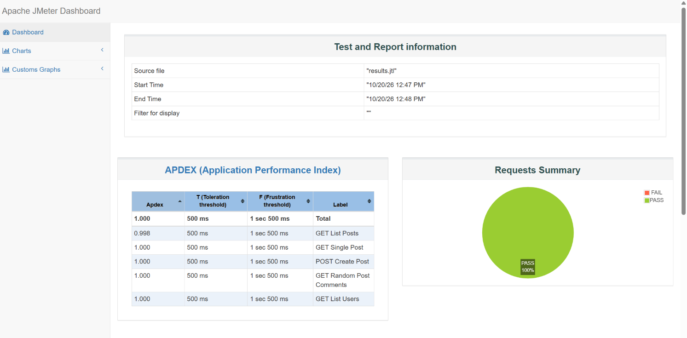
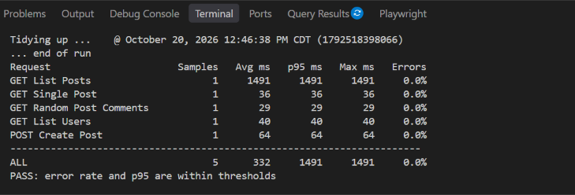

# JMeter API Performance Tests

Performance test suite built with Apache JMeter against the public [JSONPlaceholder](https://jsonplaceholder.typicode.com) REST API. It runs smoke, load and stress scenarios, checks results against pass/fail thresholds, and runs in CI with GitHub Actions.

## What was tested

One test plan (`jmeter/api_load_test.jmx`) simulates a user session with five requests per iteration:

| Request | Endpoint | Checks |
|---|---|---|
| GET List Posts | `/posts` | Status 200, first post has `userId` |
| GET Single Post | `/posts/1` | Status 200, `id` equals 1 |
| GET Random Post Comments | `/posts/{1-100}/comments` | Status 200, first comment has `postId` |
| GET List Users | `/users` | Status 200, first user has `email` |
| POST Create Post | `/posts` | Status 201, title echoed back |

Every request must also respond in under 3 seconds. A 500 ms think time between requests mimics a real user.

## Scenarios

| Scenario | Virtual users | Ramp-up | Iterations per user |
|---|---|---|---|
| smoke | 1 | 1 s | 1 |
| load | 20 | 20 s | 10 |
| stress | 40 | 30 s | 10 |

After each run, `scripts/check_results.py` prints a per-request table (samples, average, p95, max, errors) and fails if the error rate is above 1% or the overall p95 is above 2000 ms. Both limits can be changed with `--max-error-pct` and `--max-p95-ms`.

## Tools

- Apache JMeter 5.6.2
- Python 3 (results checker, standard library only)
- GitHub Actions

## How to run

Install JMeter and Java 17+, then set `JMETER_HOME` to the JMeter folder (or put `jmeter` on your PATH).

Windows (PowerShell):

```powershell
$env:JMETER_HOME = "C:\path\to\apache-jmeter-5.6.2"
.\scripts\run_load_test.ps1 -Scenario smoke
.\scripts\run_load_test.ps1 -Scenario load
```

macOS / Linux:

```bash
export JMETER_HOME=/path/to/apache-jmeter-5.6.2
./scripts/run_load_test.sh smoke
./scripts/run_load_test.sh load
```

Each run writes to `results/<scenario>/`:
- `results.jtl`: raw samples
- `report/index.html`: JMeter's HTML dashboard (response times over time, throughput, percentiles, errors)

To edit the plan visually, open `jmeter/api_load_test.jmx` in the JMeter GUI. Use the GUI for editing only; run tests from the command line.

## CI

`.github/workflows/performance.yml` installs JMeter, runs the smoke and load scenarios, fails the build if a threshold is broken, and uploads the reports as a build artifact.

## Results




